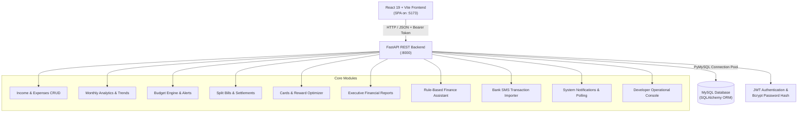

# FinTrack — Personal Finance Management Web Application

FinTrack is a full-stack personal finance and expense management platform developed for college project submission. It provides comprehensive financial tracking, budget control, payment card management, card reward optimization, non-duplicative split bill settlements, executive reporting, an AI finance assistant, and an automated bank SMS transaction workflow.

---

## 🏛️ System Architecture



---

## 🚀 Key Features Implemented

### 1. Authentication & Role-Based Access Control (RBAC)
- Secure user registration and JWT-based authentication with salted bcrypt password hashing (`passlib[bcrypt]`).
- Role separation (`USER` and `DEVELOPER`) with role-protected endpoints (`require_developer`).
- Strict user-level data isolation on all personal finance endpoints.
- Password hashes, tokens, PINs, CVVs, and secrets are strictly excluded from API responses and audit logs.

### 2. Transaction Management & Analytics
- Multi-source income and expense logging with categorized merchant and payment details.
- Positive amount validation (`amount > 0`) returning HTTP 400 on non-positive input.
- Transaction history with per-row deletion (`🗑️`) and automatic state refresh.
- Monthly analytics, month-over-month comparisons with zero-division safeguards, and category-wise spending distribution.
- Date-filtered analytics across custom date ranges.

### 3. Budget Engine & Alerts
- Category budgets with duplicate prevention (HTTP 409 Conflict check for matching category and date range).
- Real-time limit tracking and status alerts (On Track, Near Limit ≥80%, Over Budget).
- Automatic database notification generation when expenses approach or exceed budget thresholds.

### 4. Split Bills & Settlement Tracking
- Create split bills with participant assignment and custom share calculations (validating total matches sum of shares).
- Registered user lookup for seamless participant linking, plus guest participant support.
- Individual settlement recording preventing over-settlement (HTTP 400).
- Non-duplicative liability tracking: personal split shares are kept separate from direct personal expenses.

### 5. Payment Cards & Reward Optimizer
- Register payment cards (Debit/Credit) with masked numbers (`•••• 1234`), issuer, and expiry validation.
- Zero sensitive data storage: full 16-digit card numbers, CVVs, and PINs are never accepted or stored.
- Configure card benefits (cashback %, reward points multipliers, conditions).
- Link card payments to expense transactions with recorded rewards earned.
- **Card Benefit Recommendations:** Matches configured card benefits against historical category spending to recommend the highest-earning card for each transaction category without fabricating reward values.

### 6. Executive Financial Reports
- Comprehensive financial statement aggregating direct income, direct expenses, user's assigned split-bill share, planned allocations, and card rewards earned.
- Mathematical precision with decimal arithmetic to avoid floating-point inaccuracies.
- Distinguishes actual transaction outflows from planned targets and estimated rewards.
- Dedicated print layout (`@media print`) suitable for saving as PDF or printing cleanly through the browser dialog.

### 7. AI Finance Assistant (Deterministic Rule-Based)
- Analytical assistant evaluating authenticated user metrics directly from MySQL records.
- Evaluates spending hotspots, budget health, savings rate benchmarked against the 50/30/20 rule, and card advice.
- **Privacy & Reliability:** Operates deterministically on authorized user data without sending sensitive credentials or transactions to third-party generative models, ensuring zero hallucinated math, zero external API cost, and instant response time.

### 8. Bank SMS Transaction Importer & Security Filtering
- Regex parser supporting standard Indian and global bank SMS formats (UPI, debit/credit cards, netbanking, salary credits).
- Extracts transaction direction (Debit/Credit), amount, merchant, date, and payment mode.
- **Security Rejection:** Automatically rejects OTP / security verification messages (HTTP 422) and promotional marketing spam (HTTP 422).
- **Idempotency & Duplicate Detection:** Warns if an identical transaction amount and date already exists before saving to MySQL.
- Review before confirmation step allowing manual adjustments.

### 9. System Notification Center
- Automated alerts triggered by budget limit thresholds (Near Limit ≥80%, Over Budget), split bill settlements, and incoming SMS imports.
- Unread badge counter and floating notification drawer with mark-as-read and mark-all-read capabilities.
- **Delivery Mechanism:** Event-driven database insertion with action-based UI updates and 30-second background polling.

### 10. Developer Operational Console
- Operational dashboard visible exclusively to authenticated accounts with the `DEVELOPER` role.
- Aggregates operational system metrics (user counts, transaction records, budget totals) and real-time audit logs without exposing private financial transactions or user credentials.

---

## 🛠️ Technology Stack

- **Frontend:** React 19, Vite v8.3.3, Vanilla CSS (modular design tokens, responsive layouts, print styles)
- **Backend:** FastAPI, Python 3.10+ (tested and verified with Python 3.14.4), Pydantic v2, Python-Jose (JWT), Passlib (Bcrypt)
- **Database:** MySQL 8.0, SQLAlchemy 2.1 (ORM), PyMySQL
- **Testing:** Python `unittest` suite (10 automated test suites)

---

## ⚙️ Environment Configuration

Create a `.env` file inside the `backend/` directory:

| Variable | Description | Example / Placeholder |
|---|---|---|
| `DB_USER` | MySQL database username | `root` |
| `DB_PASSWORD` | MySQL database password | `your_mysql_password` |
| `DB_HOST` | MySQL database host | `localhost` |
| `DB_PORT` | MySQL database port | `3306` |
| `DB_NAME` | MySQL database schema name | `fintrack` |
| `JWT_SECRET_KEY` | Secret key for signing JWT tokens | `your_secure_random_jwt_secret_key` |

> ⚠️ **Security Notice:** Never commit actual database passwords or JWT secret keys to version control.

---

## 💻 Installation & Startup Instructions

### Prerequisites
- Node.js (v18+) & npm
- Python (v3.10+, tested on Python 3.14.4)
- MySQL Server 8.0 (running with the `fintrack` database schema created)

### 1. Database Initialization
Ensure MySQL is running and create the database schema:
```sql
CREATE DATABASE IF NOT EXISTS fintrack;
```
SQLAlchemy automatically creates all 13 tables on backend startup using `Base.metadata.create_all(bind=engine)`.

### 2. Backend Setup & Startup
```bash
# Navigate to backend directory
cd backend

# Create and activate virtual environment
python -m venv venv
# Windows (PowerShell):
.\venv\Scripts\Activate.ps1
# Linux/macOS:
source venv/bin/activate

# Install dependencies
pip install fastapi uvicorn sqlalchemy pymysql python-dotenv python-jose[cryptography] passlib[bcrypt] pydantic email-validator python-multipart

# Start FastAPI development server
uvicorn main:app --reload --port 8000
```
Backend will be live at `http://localhost:8000`. Swagger API documentation is available at `http://localhost:8000/docs`.

### 3. Frontend Setup & Startup
```bash
# Navigate to frontend directory
cd frontend

# Install dependencies
npm install

# Start Vite development server
npm run dev
```
Frontend will be live at `http://localhost:5173`.

---

## 🧪 Automated Testing

FinTrack includes an automated test suite verifying authentication, user isolation, payment card lifecycle, reporting accuracy, AI assistant, bank SMS detection, duplicate budget prevention, and split settlements.

```bash
# From the repository root (Windows):
backend\venv\Scripts\python backend/test_suite.py

# Or from the backend directory:
cd backend
.\venv\Scripts\python test_suite.py
```

### Verified Test Suite Results (10 / 10 Passing):
1. `test_01_user_profile`: JWT verification and authenticated profile retrieval.
2. `test_02_card_lifecycle_and_user_isolation`: Card creation, benefit addition, card usage linking, and HTTP 404 enforcement on cross-user card access.
3. `test_03_financial_reports_summary`: Cash flow calculations, category breakdown, and personal split share calculation.
4. `test_04_ai_assistant_query`: Spending hotspots analysis and card reward advisory.
5. `test_05_bank_sms_parse_and_confirm`: SMS regex extraction, transaction confirmation, duplicate detection, OTP rejection (422), promo spam rejection (422), and direction validation (422).
6. `test_06_budget_conflict_and_alert_calculation`: HTTP 409 conflict on duplicate budget submission and negative remaining budget calculations.
7. `test_07_income_allocation_and_split_settlement`: Planned allocations tracking and split participant settlement status updates.
8. `test_08_notifications_lifecycle`: Authenticated notification listing, unread count tracking, user isolation rejection (404), and mark-as-read workflows.
9. `test_09_income_expense_validation_and_deletion`: Non-positive amount input validation (HTTP 400), transaction deletion with ownership verification, and cascade cleanup.
10. `test_10_developer_role_enforcement`: RBAC access control (HTTP 403 for standard users, HTTP 200 for developers), and validation that sensitive credentials are never leaked.

---

## 📋 MySQL Schema Overview

| Table | Primary Key | Description |
|---|---|---|
| `users` | `user_id` | User accounts, password hashes, and roles (`USER`, `DEVELOPER`) |
| `income` | `income_id` | Income transactions, sources, dates, and amounts |
| `expenses` | `expense_id` | Expense transactions, categories, merchants, and dates |
| `budgets` | `budget_id` | Spending limits per category and date period |
| `income_allocations` | `allocation_id` | Planned savings targets and budget commitments |
| `cards` | `card_id` | Payment cards metadata (issuer, type, network, last 4 digits) |
| `card_benefits` | `benefit_id` | Configured card rewards (cashback %, points, conditions) |
| `card_usage` | `usage_id` | Records of card usage linked to specific expenses and benefits |
| `split_bills` | `split_bill_id` | Shared bills and total bill amounts |
| `split_participants` | `participant_id` | Individual participant shares, amounts paid, and settlement status |
| `settlements` | `settlement_id` | Recorded settlements against participant shares |
| `notifications` | `notification_id` | System and user alert notifications |
| `audit_logs` | `log_id` | System audit trail tracking create, update, and delete actions |

---

## ⚠️ Known Limitations & Scope Notes

1. **Browser Sandboxing vs Native Android SMS:** Web applications run inside browser security sandboxes that prohibit direct reading of device SMS inboxes. FinTrack implements manual paste/payload ingestion with regex extraction, OTP rejection, promo rejection, duplicate warning, and user confirmation. Automated background SMS reading requires packaging the frontend as a native Android app (via Capacitor, React Native, or native Kotlin) with `RECEIVE_SMS` runtime permissions.
2. **Card Security & PCI Scope:** FinTrack deliberately does not process live payment card transactions or store complete 16-digit card numbers, CVVs, or PINs. Only card nicknames, issuers, and the last 4 digits are recorded for budgeting and reward comparison purposes.
3. **Split Bill Categories:** The `split_bills` schema records bill title, total amount, and participant shares without a dedicated `category` column. Personal split shares are tracked as overall liabilities in cash flow reports rather than categorized expenses.
4. **Notification Delivery:** Notifications are updated via action triggers, page loads, and 30-second client-side background polling rather than WebSockets.
